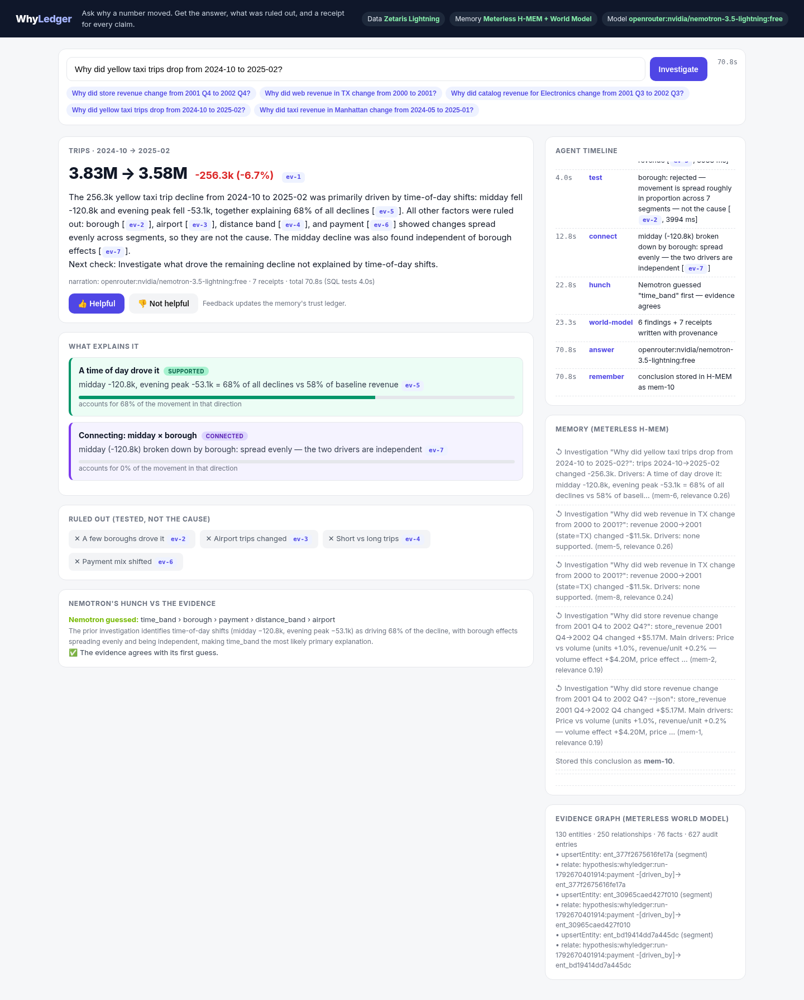
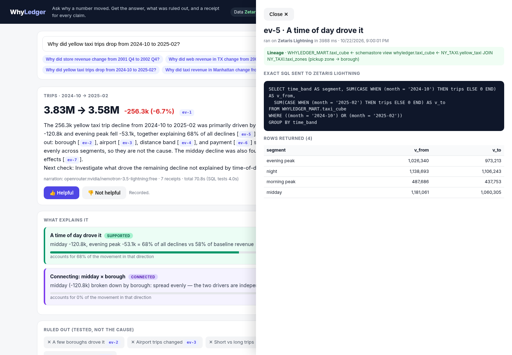
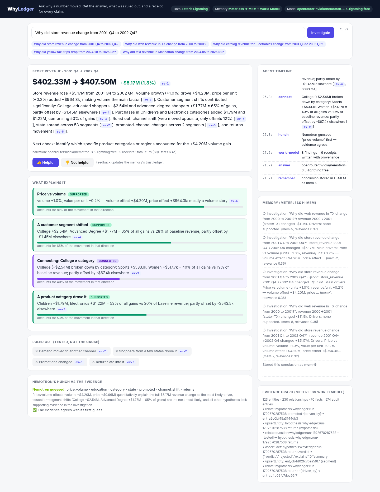
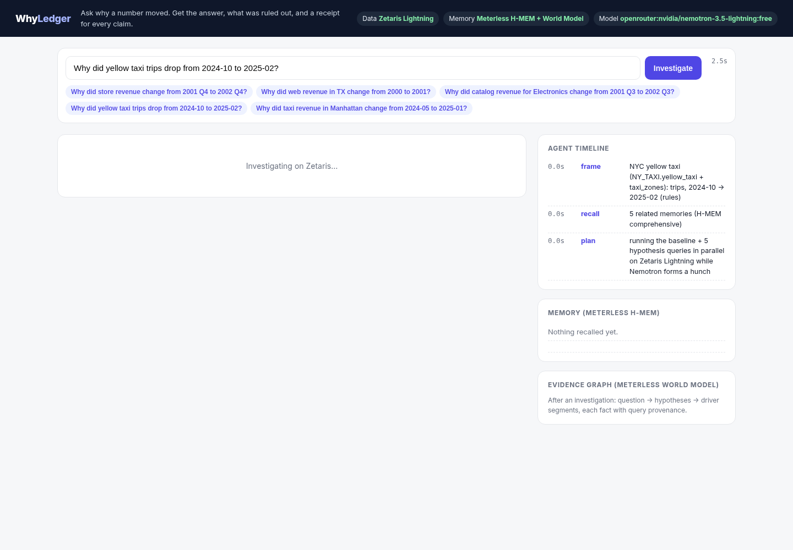
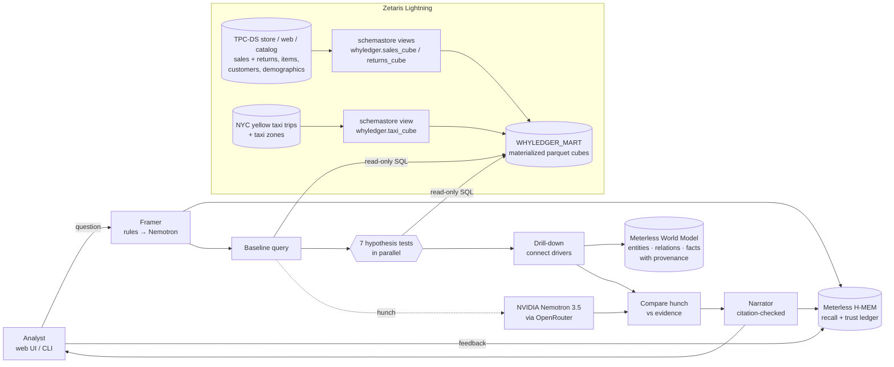

# WhyLedger

**Ask why a business number moved. Get the answer, what was ruled out, and a receipt for every claim.**

Open Agent Hackathon 2026 · Track 02 *The Agent That Can Explain Why* · team Charlie Agents

**[▶ Demo video (2:42)](https://github.com/777sun77/whyledger/releases/download/v1.0/demo.mp4)** · **[Pitch deck (PDF)](docs/media/deck.pdf)** · **[Evaluation results](eval/README.md)** · [Sponsor details](#how-we-use-the-sponsors) · [Built with Cursor](docs/CURSOR.md)

> **Evaluated, not just demoed.** On 17 planted-cause scenarios WhyLedger found the hidden cause in 16, named the right segment, and blamed nothing in both no-cause controls. On the real Zetaris instance, 33/33 citations were valid, 19/19 numbers in Nemotron's answers matched the SQL results, and the semantic-layer baselines matched an independent raw-table recompute exactly. [Details →](eval/README.md)

## The problem, in one Monday morning

*(An illustrative user, with numbers from a real run on Zetaris.)* Dana runs operations for a retailer. At Monday's review the CFO asks: *"Store revenue is up $5M year on year. Why? And are returns hiding anything?"* Today Dana's analyst pulls store, web and catalog sales, returns and customer data from separate systems, pivots for half a day, and comes back with a slide. The slide can't show which query produced each number, and it doesn't say what was checked and ruled out, so next quarter the same suspects get checked again. A chatbot is faster but worse: fluent text with numbers nobody can trace.

With WhyLedger, Dana types the question. About a minute later she has the answer *mostly volume (81%), led by College and Advanced-Degree shoppers and by Children's and Electronics products*. She also sees what was ruled out (*channel shift, shopper states, promotions, returns*), each with its own receipt. Any number can be clicked to show the exact Zetaris SQL and the rows behind it. When she marks the answer helpful, Meterless records that in its trust ledger, and the next investigation recalls it.

**Who it's for:** retail and store operations managers, and FP&A or business analysts who must explain KPI changes to leadership. **Impact:** half a day of manual querying becomes about a minute, and the answer is audit-ready, so it can go straight into the deck.

## For judges: where to look

| Criterion | Evidence |
|---|---|
| Impact | The user story above. One question replaces half a day of cross-system querying, and the answer comes back audit-ready. |
| Technical execution | 7 Zetaris SQL scripts build a federated semantic layer and materialized cubes; the baseline and every hypothesis run in parallel (1.8 s of SQL per investigation); `npm test` and `tsc` pass; there are [two evaluations](eval/README.md). |
| Innovation | "Ruled out" is a first-class output. Nemotron's hunch is checked against the evidence. Citation **and** numeric grounding guards. The World Model fact graph carries SQL checksums. |
| Demo | [2:42 video](https://github.com/777sun77/whyledger/releases/download/v1.0/demo.mp4) of live runs on Zetaris across two domains (retail and NYC taxi) |
| Product & UX | Streaming timeline, an answer card, a ruled-out panel, receipt chips that open the exact SQL and rows, 👍/👎 feedback |
| Sponsor use | [Zetaris and Meterless details with code pointers](#how-we-use-the-sponsors) |

## How it works

WhyLedger runs this loop for every question:

1. **Frames** the question: dataset, metric, periods, and filters such as *web revenue in TX* or *taxi revenue in Manhattan*.
2. **Recalls** earlier investigations and analyst feedback (Meterless H-MEM).
3. **Measures** the change with one query on Zetaris (receipt `ev-1`).
4. **Tests every hypothesis in parallel** on Zetaris: price vs volume, segment mix, geography, promotions, channel shift, returns, surcharges. Each test is one read-only SQL query, and its exact SQL and rows are kept as a receipt.
5. **Connects** findings by drilling the strongest driver into the next dimension (for example, *College shoppers × category*).
6. **Ruling out is first-class.** Hypotheses the data rejects appear in their own panel with receipts, so "we checked returns: not it" is visible.
7. **Compares** Nemotron's up-front hunch with the evidence. The receipts win when they disagree.
8. **Writes the evidence graph** to the Meterless World Model, so every fact carries provenance (the query, its checksum and the backend).
9. **Narrates** with Nemotron, but numbers never come from the model. Two guards run on every answer: each cited receipt id must exist (**citation check**), and every number in the text must appear in the SQL results (**numeric grounding check**, `src/agent/grounding.ts`). If either fails, a deterministic template is shown instead.
10. **Learns**: 👍/👎 feedback goes into H-MEM's append-only trust ledger and shapes the next recall.

## Screenshots

| Answer with findings, ruled-out panel and Nemotron hunch | Receipt drawer: exact Zetaris SQL, rows, lineage |
|---|---|
|  |  |

| Retail run: answer and drivers | Live agent timeline while the tests run in parallel |
|---|---|
|  |  |

## Architecture



## Run it

Requirements: Node 20+, Docker, and the Zetaris developer edition (local Docker).

```bash
npm install
npm run setup                 # vendors the pinned Meterless engines (H-MEM, World Model) into vendor/
cp .env.example .env.local    # fill in ZETARIS_* and OPENROUTER_API_KEY (or NVIDIA_API_KEY)

# Zetaris: start the developer edition, then build WhyLedger's semantic layer once
~/zetaris/start.sh            # or: docker compose up -d in the Zetaris platform folder
npm run zetaris:setup         # runs zetaris/01..07_*.sql in order (re-runnable)

npm run serve                 # http://localhost:8787
npm run investigate -- "Why did yellow taxi trips drop from 2024-10 to 2025-02?"
```

There is also an offline mode with no Zetaris and no keys: `npm run seed:local`, then `WHYLEDGER_BACKEND=local WHYLEDGER_LLM=none npm run serve`. It runs the same cube SQL on DuckDB over TPC-DS sf0.1. It is for development only; the demo runs on Zetaris.

For recorded demos, `WHYLEDGER_DEMO_CACHE=1` keys cached Nemotron replies by question, so a replay is instant. The SQL still runs live on Zetaris.

Tests: `npm test` (scoring, bounds, SQL guard, framing, grounding) and `npm run typecheck`.
Evaluations: `npm run eval:planted` (offline, planted causes) and `npm run eval:zetaris` (live, faithfulness). See [eval/README.md](eval/README.md).

### Example questions

| Dataset (federated in Zetaris) | Question |
|---|---|
| Retail, TPC-DS (3 sales channels, returns, customers, demographics) | *Why did store revenue change from 2001 Q4 to 2002 Q4?* |
| Retail, filtered | *Why did web revenue in TX change from 2000 to 2001?* |
| NYC yellow taxi + taxi zones | *Why did yellow taxi trips drop from 2024-10 to 2025-02?* |
| NYC taxi, filtered | *Why did taxi revenue in Manhattan change from 2024-05 to 2025-01?* |

## How we use the sponsors

### Zetaris Lightning (required): the data layer
- **Federation across fragmented sources.** `zetaris/01_sales_cube.sql` unions the store, web and catalog sales tables and joins them with dates, items, customer addresses and demographics. `02` does the same for returns. `06` joins NYC trip records with the taxi-zone lookup. All of this happens in Zetaris SQL as `CREATE SCHEMASTORE VIEW`s, so WhyLedger only ever sees one semantic layer.
- **Materialized investigation cubes.** `03` creates the `WHYLEDGER_MART` Lightning database. `04`, `05` and `07` materialize each view with `CREATE LIGHTNING FILESTORE TABLE … FORMAT PARQUET`. Hypothesis queries dropped from 15–45 s (raw federated scans) to well under a second each. That is what makes a full investigation fit in about a minute.
- **Every number is a Zetaris query.** `src/data/zetaris.ts` sends read-only SQL through the Lightning SQL API. A guard in `src/data/backend.ts` rejects anything except `SELECT`/`WITH`. The exact SQL, the rows, the timing and the lineage (which sources feed the cube) are shown in the UI's evidence drawer.

### Meterless (required): memory and evidence graph
Reference engines pinned to `Meterless/Meterless@1742dec` (Apache-2.0) and vendored by `npm run setup`.
- **H-MEM** (`src/memory/meterless.ts`, `investigator.ts`, `server.ts`): recall with a retrieval trace before every investigation, storage of each conclusion, and analyst feedback through the **trust ledger** (`/api/feedback`, `/api/memory/audit`). The UI shows the ledger history.
- **World Model** (`writeWorld()` in `investigator.ts`): the investigation becomes an event-sourced graph, question → *tested* → hypothesis → *driven_by* → segment. Every `assertFact` carries provenance: backend, SQL and a sha-256 checksum of the query and its rows. The audit log is shown in the UI.

### NVIDIA Nemotron (optional prize)
`nvidia/nemotron-3.5-lightning` is reached through OpenRouter's free endpoint (an NVIDIA NIM provider is also wired in `src/llm/provider.ts`). Nemotron frames unusual questions, forms a hunch in parallel with the SQL tests, which is then checked against the evidence, and narrates the answer under a citation check. Calls are disk-cached (`.whyledger/llm-cache.json`), and both the hunch and the narration have time budgets, so a slow model can never block an answer.

## Why the answers can be trusted
- Numbers come only from SQL. The model receives already-computed findings, and a grounding check rejects any narration that contains a number not found in them.
- The model must respect verdicts: only *supported* findings may be called causes. When nothing is supported, the answer says the change is broad-based.
- Attribution is bounded. Segment shares never exceed 100%, and changes under 1% are capped at "partial" so noise is never reported as a cause.
- Offsetting movements (such as a web decline during store growth) are labelled as co-movement, not proof of switching.
- Hypotheses the data rejects are reported as ruled out, with their receipts.

## Limitations (honest list)
- **Hypotheses are a fixed menu per dataset** (segments, price vs volume, channel shift, returns, surcharges, time of day). WhyLedger tells you which of these explain a change, so a cause outside the menu (a competitor opening, a weather event) shows up as "broad-based, no single cause". Guarded model-proposed hypotheses are the next step.
- **Explanations are decompositions, not causal proof.** Offsetting channel moves are labelled co-movement, and confounded segments can co-move. The planted-cause eval's one miss is such a case, and the drill-down makes the link visible.
- **Sample data.** The demos run on the TPC-DS and NYC TLC samples that ship with the Zetaris developer edition, not on a customer's warehouse. The semantic layer is plain Zetaris SQL (`zetaris/*.sql`), so pointing it at real sources means rewriting the view definitions.
- **Free-tier model latency.** Nemotron runs on OpenRouter's free tier, so narration can take up to 75 s or time out. When it does, the template answer (same findings, same receipts) is shown.
- Single-user local app: there are no auth, multi-tenant memory or scheduled monitoring yet.

## Built with Cursor
See [docs/CURSOR.md](docs/CURSOR.md).

## Layout
```
src/agent/   framing.ts (question → frame) · datasets.ts (cubes, hypotheses, SQL) · investigator.ts (the loop, scoring, narration) · grounding.ts (numeric check)
src/data/    zetaris.ts (Lightning SQL API) · local.ts (DuckDB dev fallback) · backend.ts (read-only guard)
src/memory/  meterless.ts (H-MEM + World Model)
src/llm/     provider.ts (Nemotron via OpenRouter / NVIDIA NIM, disk cache)
zetaris/     01–07 SQL: semantic layer + materialized mart
web/         index.html (single-file UI, server-sent events)
eval/        planted-cause + Zetaris faithfulness evaluations and results
scripts/     setup, zetaris:setup, eval-planted.ts, eval-zetaris.ts
docs/media/  deck.pdf, demo.mp4
```

License: Apache-2.0.
